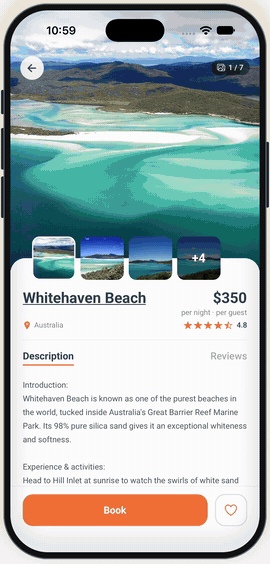
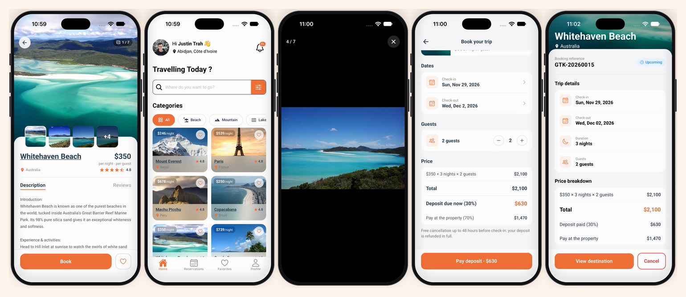

# GlobeTrek

A travel booking app, from design to code: browse destinations, book a stay and pay a 30% deposit with Stripe.
React Native (Expo) on the mobile side, Node.js / Express with Prisma and MySQL on the API side.

<p align="center">
  
</p>



## Features

- **Onboarding and accounts**: sign up, sign in, password reset with a code sent by email, profile and avatar
- **Explore**: destinations by category, search, filters (price, rating, sort), favorites
- **Destination page**: swipeable photo gallery with a full-screen viewer, description, traveler reviews
- **Booking**: dates and number of guests, live price, 30% deposit due now and the rest paid at the property
- **Stripe payment**: the deposit is computed on the server, confirmation is idempotent so a booking can never be charged twice
- **Cancellation**: the deposit is refunded automatically when cancelling more than 48 hours before check-in
- **Trips and notifications**: upcoming and past reservations, booking and payment notifications

## Tech stack

| | |
|---|---|
| Mobile | React Native 0.88, Expo SDK 58, TypeScript, Expo Router, TanStack Query, Zod |
| API | Node.js, Express 5, Prisma 6, MySQL |
| Auth | JWT access tokens with rotating refresh tokens, bcrypt, rate limiting |
| Payments | Stripe PaymentIntents and PaymentSheet (`@stripe/stripe-react-native`) |
| Services | Brevo (transactional email), Cloudinary (avatars) |
| Tests | Node test runner (API), Maestro end-to-end flows (iOS and Android) |

## Project structure

```
backend/   Express API, Prisma schema and migrations, seeds, destination photos (public/images)
mobile/    Expo app: screens in app/ (Expo Router), components, hooks, services, Maestro flows in .maestro/
docs/      Design notes and README media
```

## Getting started

Requirements: Node.js 20+, MySQL 8, a Stripe account in test mode, and Expo Go or a simulator.

### 1. API

```bash
cd backend
npm install
cp .env.example .env      # fill in DATABASE_URL, JWT secrets, STRIPE_SECRET_KEY, Brevo, Cloudinary
npx prisma migrate deploy
npm run db:seed           # demo destinations, a demo account, reservations and notifications
npm run dev               # http://localhost:5001
```

`npm run db:seed` resets the data. To refresh destination texts and photos while keeping bookings, use `npm run db:sync-content`.

### 2. Mobile app

```bash
cd mobile
npm install
cp .env.example .env      # EXPO_PUBLIC_STRIPE_PUBLISHABLE_KEY=pk_test_...
npx expo start
```

In development, the app finds the API on the machine running Metro (port 5001), so there is no IP address to configure.
Set `EXPO_PUBLIC_API_URL` in `mobile/.env` to point to another server.

### Demo account and test card

- Email `justin@globetrek.com`, password `password123` (created by the seed)
- Stripe test card `4242 4242 4242 4242`, any future expiry date, any CVC

## Tests

```bash
cd backend && npm test                                     # API unit tests
cd mobile && APP_URL=exp://<LAN-IP>:8081 npm run test:e2e:ios       # Maestro flows on iOS
cd mobile && APP_URL=exp://<LAN-IP>:8081 npm run test:e2e:android   # Maestro flows on Android
```

The Maestro flows cover search and filters, favorites, the photo gallery, a full booking paid with the Stripe test card, and logout.

## Credits

Destination photos come from [Wikimedia Commons](https://commons.wikimedia.org) under free licences.
Authors and licences are listed in [`backend/public/images/CREDITS.md`](backend/public/images/CREDITS.md).
